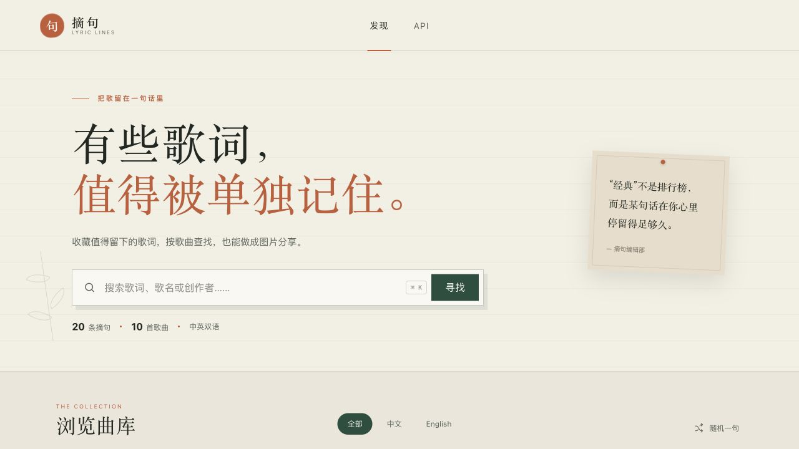
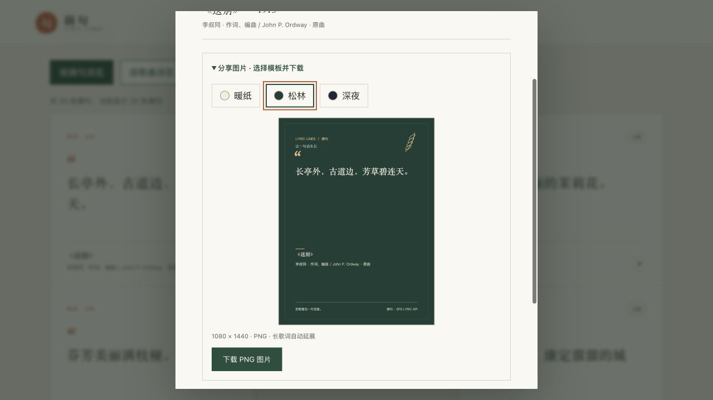
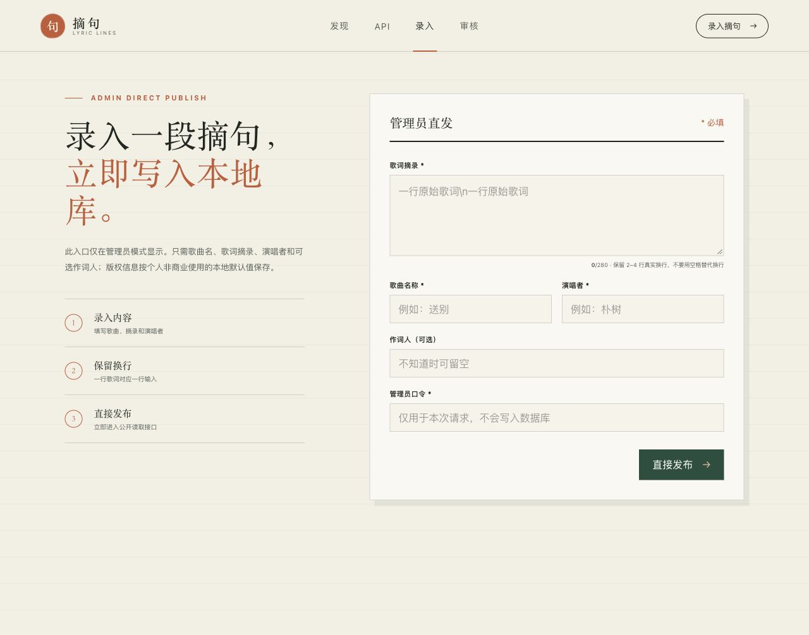
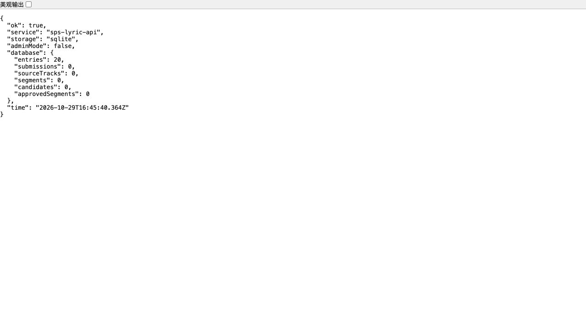

# 我把喜欢的歌词做成了一个开源收藏站：摘句

有些歌听过很久，最后记住的却只有两三行。它们可能躺在手机备忘录里，也可能是一张不记得出处的截图。再想找的时候，要么忘了歌名，要么只剩一个模糊的关键词。

我做了一个小工具，把这些值得留下的句子放到一起。它叫「摘句」，仓库名是 **sps-lyric-api**。现在把应用代码开源，喜欢折腾、自建服务，或者想整理自己的歌词收藏的朋友，可以拿去运行和修改。

仓库地址：[github.com/onvno/sps-lyric-api](https://github.com/onvno/sps-lyric-api)

这里的“开源”指代码开放、自行部署。项目包含网页运行所需的读取接口，但目前不把托管公共 API 作为对外服务。

## 先看看效果

首页围绕歌词摘句展开，可以搜索歌词、歌名或创作者，也能切换为按歌曲浏览。在歌曲列表中展开一首歌，就能看到它的摘句。搜索和语言筛选作用于整个已发布曲库，列表有分页，不需要靠猜关键词才能找到后面的内容。



上图来自实际 Docker 演示环境。仓库默认提供 **20 条演示摘句**，用于体验功能；文章里的数字不代表附送一个完整商业歌词库。你可以随后录入、导入自己确认适用范围的内容。

## 把喜欢的几行，留成一张图片

点开一条摘句，除了歌词本身，还能看到歌曲、创作者及来源说明。展开“分享图片”，可以在三种风格里选择：暖纸、松林和深夜。



导出的是 PNG，宽度为 1080 像素。短摘句使用竖版布局，长内容会自动换行并延展画布，歌名和创作者署名也会保留。对于旧中文歌词里用空格分隔的歌词行，分享图片会按行展示；英文单词之间的正常空格会保留。

图片在浏览器本地生成，不需要把歌词传给截图或图片生成服务。换个模板、看一下预览，再下载即可。

## 浏览和管理分开

默认启动后，网页是只读浏览模式。需要维护内容时，再显式启用管理员模式并设置自己的口令。



管理有两条常用路径：

1. 已经确定要保存的几行歌词，可以在“录入”中填写歌名、歌词、演唱者和可选作词人，直接发布。
2. 想从完整歌词里挑选摘句，可以上传或从支持的来源导入，在本地生成候选，再逐条核对和批准。

本地候选库支持搜索歌名、歌手、词曲作者和来源编号，能切换“有待审候选”或“全部来源歌曲”，也能查看已经发布、驳回或被自动过滤的片段。

目前它还没有完整的已发布条目编辑、下架界面，也不会自动替你判断一段歌词的来源和使用范围。这些边界在管理员手册中有说明。

## 怎么部署

应用使用 Node.js 和 SQLite。没有额外的数据库服务，数据保存在本机文件里。

如果已经有 Node.js 22.5 或更新版本，可以直接运行：

```bash
git clone https://github.com/onvno/sps-lyric-api.git
cd sps-lyric-api
npm ci
npm start
```

打开 `http://localhost:8787`。首次运行会自动建立数据库、载入演示摘句，不必先去下载数据库附件。

更习惯 Docker 的话，也可以在 macOS 或 Linux 上这样运行；Windows 用户可在 WSL 中执行：

```bash
git clone https://github.com/onvno/sps-lyric-api.git
cd sps-lyric-api
cp .env.example .env
mkdir -p data dist/releases
printf 'LOCAL_UID=%s\nLOCAL_GID=%s\n' "$(id -u)" "$(id -g)" >> .env
docker compose up -d --build --wait
```

宿主机不需要另装 Node.js，打开的仍是 `http://localhost:8787`。如果端口被占用，修改 `.env` 的 `PORT` 即可。



部署后可以访问 `/api/health` 检查状态。上图为演示环境的真实返回：SQLite 存储，20 条演示摘句，管理员模式关闭。截图使用独立测试端口，不是默认端口。

## 数据由自己掌握

运行数据库挂载在宿主机 `data/` 目录，重新构建容器不会把它清空。代码更新与数据库更新分开，升级应用也不会自动替换个人收藏。

为了避免把私人资料误当成公开附件，项目将两个操作分开：

- `npm run db:release -- --version 版本`：只从仓库演示种子生成数据库附件，不读取你的个人运行库。
- `npm run db:backup -- --version 版本`：生成完整本地备份，可能含原始歌词、候选和内部记录，应保存在自己的存储中。

数据库安装提供校验、替换前备份和回滚，但采用整库替换，并不是增量合并。已经维护了自己的曲库时，不要把安装别人发布的数据库当成普通的软件升级。

## 关于开源与内容

应用代码采用 MIT License。第三方歌词和数据库内容有各自的来源及使用条件，不因为代码开源就一起获得 MIT 授权。演示记录附有出处和权利说明，具体使用和再分发仍需要按实际情况核对。

这也是我把它定位为“自己的歌词摘句收藏工具”的原因：应用负责整理、查找、展示与分享，内容由使用者认真维护。

如果你想搭一个自己的歌词收藏站，欢迎试用；如果发现部署、换行或导出图片的问题，也欢迎通过仓库 Issues 提交环境和复现步骤。歌词建议则有独立模板，可以附上短摘句、署名和来源。

- [源码仓库](https://github.com/onvno/sps-lyric-api)
- [安装与使用说明](../README.md)
- [管理员手册](../ADMIN.md)
- [部署、备份与回滚](deployment.md)
- [许可边界](../NOTICE.md)

---

配图说明：本文截图在 2026-10-30 使用隔离的演示数据库拍摄，未展示维护者的完整个人曲库或实际管理员口令。发布文章时可直接沿用这些相对路径图片，转载到其他平台时需要一并上传图片文件。
